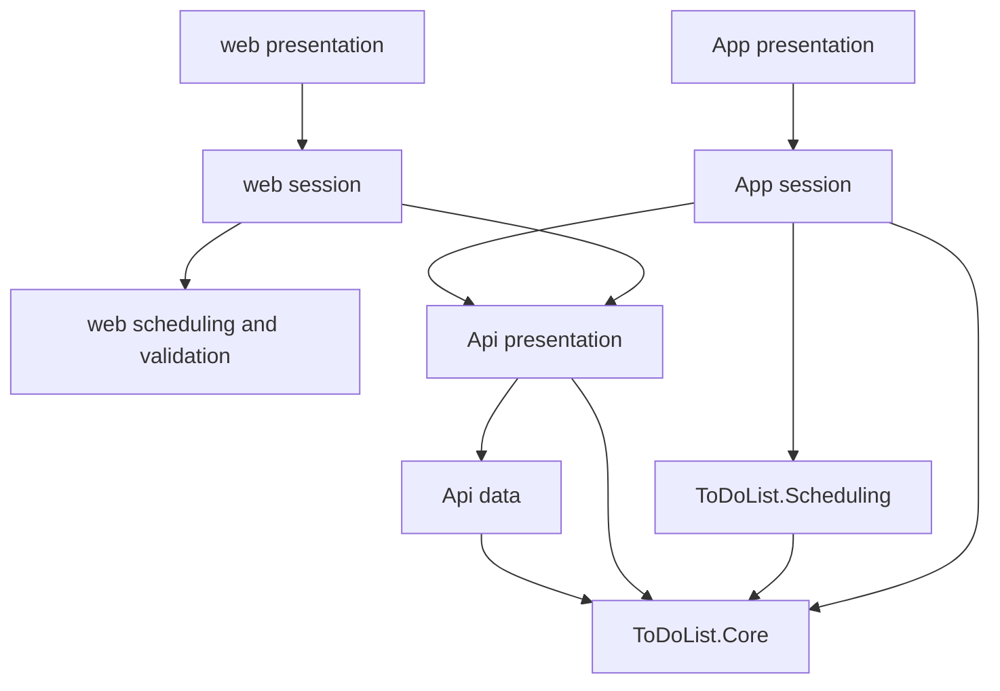

# Architecture Spine — ToDoList projects

## Design Paradigm

Concrete layers. Each layer is a project or a folder of concrete types. A layer is not an interface, and a new project is not added to host one. Dependencies point inward from presentation to rules, and only the API data folder talks to Cosmos.



## Inherited Invariants

Parent spine: `../architecture-ToDoList-2026-11-04/ARCHITECTURE-SPINE.md`. Paradigm there is client-computed-views. Those rules stay as written.

| Inherited | From parent | Binds here |
| --- | --- | --- |
| AD-1 | Stored facts, computed views | Scheduling and the web port compute views. The API does not. |
| AD-2 | The API is the only writer | Client HTTP folders call the Function App. They do not talk to Cosmos. |
| AD-3 | Google sign-in per client | Api Auth and each client's sign-in type. |
| AD-4, AD-5, AD-6 | Documents, schema version, etag | Core document types and Api data. |
| AD-7 | One field contract, two checks | Core ItemRules, the web validation port, and the contracts directory. |
| AD-8 | Problem-details errors | Api presentation and both HTTP clients. |
| AD-9, AD-10 | Device display state, same view results | Scheduling, the web scheduling port, and each session. |
| AD-11 | Solution shape | The project list and the ban on a storage interface. |
| AD-12 | Tokens, not hex | web tokens.css and App Colors.xaml. |
| AD-13, AD-14, AD-15 | Environments, identity, Terraform | Unchanged. This spine does not describe the Terraform repository. |

## Invariants & Rules

### AD-16 — Concrete layers [ASSUMPTION]

- **Binds:** all application projects
- **Prevents:** an infrastructure project, a repository interface, or a second home for Cosmos
- **Rule:** Presentation is `web` and `ToDoList.App`. View rules are `ToDoList.Scheduling` and the TypeScript port under `web`. The item model, schema conversion, and the field check are `ToDoList.Core`. HTTP endpoints live in `ToDoList.Api/Presentation`. Cosmos lives in `ToDoList.Api/Data` as a concrete class. Each client has an HTTP folder that calls the Function App.

### AD-17 — Dependency direction [ASSUMPTION]

- **Binds:** all application projects
- **Prevents:** the API referencing Scheduling, Scheduling standing apart from Item, or the web compiling against C#
- **Rule:** `ToDoList.Core` references no sibling project. `ToDoList.Scheduling` references Core. `ToDoList.Api` references Core and does not reference Scheduling. `ToDoList.App` references Core and Scheduling. `web` references neither. API presentation may call auth, the field check, and the Cosmos class. The Cosmos class may call Core converters. Auth does not call Cosmos. On each client, presentation calls one session type, and that session calls view rules, the field check, and the HTTP client.

### AD-18 — One contracts directory [ASSUMPTION]

- **Binds:** Core, Api, Tests, web
- **Prevents:** a second edited copy of a length limit or a view example
- **Rule:** `contracts/item-fields.json` and `contracts/view-examples.json` are the only source copies. Core, the API content root, xUnit, and Vite read those files.

### AD-19 — One session type [ASSUMPTION]

- **Binds:** ToDoList.App, web
- **Prevents:** a view-model per control, a second store, or a route table for a single board
- **Rule:** `ToDoList.App` has `ItemSession`. `web` has `itemSession`. Pages and components call that type. Hide-completed is Android Preferences on the phone and localStorage on the web. There is no MVVM toolkit, no Redux, and no React Router.

### AD-20 — Platform UI [ASSUMPTION]

- **Binds:** web, ToDoList.App
- **Prevents:** a component kit, a drag library, or a date-picker library becoming a second design system
- **Rule:** Web styling is `tokens.css` plus one stylesheet. Web sign-in uses the Google Identity Services script. Web drag uses pointer events. The date field is written in the app. Android sign-in uses Credential Manager. Project 1 adds no Tailwind, no component kit, no drag library, and no date-picker library.

### AD-21 — Tests cover rules [ASSUMPTION]

- **Binds:** ToDoList.Tests, ToDoList.Api
- **Prevents:** a Cosmos interface added so a test can fake storage
- **Rule:** `ToDoList.Tests` references Core and Scheduling and does not reference the API. The Cosmos emulator is a local run.

## Consistency Conventions

| Concern | Convention |
| --- | --- |
| Naming | One type per behavior. Folder names are Presentation, Session, Api, Auth, Data, scheduling, validation. Current types stay Account and Item. Storage types stay AccountDocumentV1 and ItemDocumentV1. |
| Data and formats | JSON stays camelCase. Clients and the API share the contracts directory. System.Text.Json on the server. |
| State and cross-cutting | The session owns the loaded items and snapback. Pages render and forward gestures. The API checks fields once, then converters and Cosmos trust the values. |

## Stack

Versions inherited from the parent spine were checked on 2026-11-04. Packages added here were checked on NuGet on 2026-11-06.

| Name | Version |
| --- | --- |
| .NET | 10 |
| .NET MAUI | 10.0.120 |
| Azure Functions isolated worker | .NET 10, ASP.NET Core integration |
| React | 19.3.1 |
| Vite | 8.3.5 |
| TypeScript | 7.0.2 |
| Node.js | 24 |
| Vitest | 5 |
| xUnit | 3, net10.0 |
| Microsoft.Azure.Cosmos | 3.63.3 |
| Google.Apis.Auth | 1.78.0 |
| Xamarin.Google.Android.Libraries.Identity.GoogleId | 1.1.0.16 |

## Structural Seed

```text
ToDoList.sln
contracts/
  item-fields.json
  view-examples.json
src/
  ToDoList.Core/                 # Account, Item, V1 documents, converter, ItemRules
  ToDoList.Scheduling/           # calendar, views, placement
  ToDoList.Api/
    Presentation/                # item routes
    Auth/                        # Google ID token
    Data/                        # CosmosDocuments
  ToDoList.App/
    Presentation/                # Add new, Board, Edit
    Session/                     # ItemSession
    Api/                         # HTTP client, Google sign-in
  ToDoList.Tests/                # Core and Scheduling
  web/src/
    presentation/
    session/
    scheduling/
    validation/
    api/
    auth/
```

File names and the sizing notes are in `project-structure.md`.

## Capability → Architecture Map

| Capability / Area | Lives in | Governed by |
| --- | --- | --- |
| Field check | Core ItemRules, web validation | AD-7, AD-16, AD-18 |
| Schema conversion | Core Documents | AD-5, AD-16 |
| Today, week, order | Scheduling, web scheduling | AD-1, AD-10, AD-17 |
| HTTP and problem-details | Api Presentation, both HTTP clients | AD-2, AD-8, AD-16 |
| Cosmos read and write | Api Data | AD-4, AD-6, AD-16, AD-21 |
| Google token | Api Auth, web auth, App Api | AD-3, AD-20 |
| Screens and gestures | App Presentation, web presentation | AD-19, AD-20 |
| Hide completed | each session | AD-9, AD-19 |

## Deferred

- The file-by-file mount of `contracts/` into the API output and the Vite bundle. AD-18 fixes a single source. The copy step can follow the tool that already builds that project.
- iOS platform projects the MAUI template creates. Project 1 publishes Android. Those folders stay unconfigured.
- The release pipeline that publishes the Function App zip and the Static Web App files. Still the parent deferral.
- Splitting `Board` if that one type becomes hard to read. Split by behavior only after it exists.
