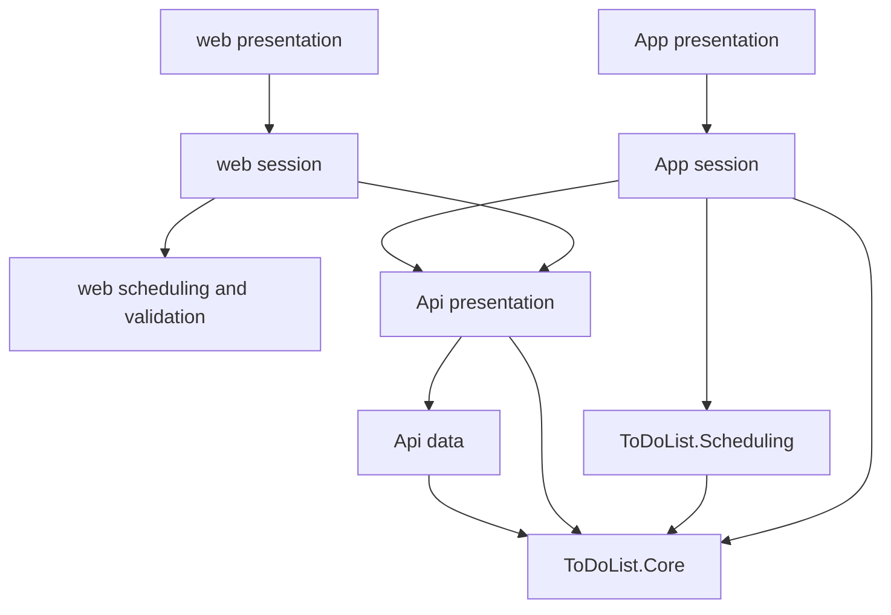

# ToDoList project 1 — Project structure

Draft for review. The build rules are AD-16 through AD-21 in [ARCHITECTURE-SPINE.md](ARCHITECTURE-SPINE.md). They inherit AD-1 through AD-15 from the project 1 spine. Tags marked [ASSUMPTION] are the calls to correct before this moves to OutputDocs.

This is the application repository. Terraform stays in its own repository, already described in `1-4_OutputDocs/terraform.md`.

The layers are the projects and the folders below. There is no infrastructure project and no storage interface. Cosmos is one concrete class in the API.

| Layer | Where it lives |
| --- | --- |
| Presentation | `web/src/presentation`, `ToDoList.App/Presentation` |
| Client session | `web/src/session`, `ToDoList.App/Session` |
| View rules | `ToDoList.Scheduling`, and a TypeScript port in `web/src/scheduling` |
| Item rules and schema | `ToDoList.Core` |
| HTTP edge | `ToDoList.Api/Presentation`, `ToDoList.Api/Auth` |
| Data access | `ToDoList.Api/Data` for Cosmos. `web/src/api` and `ToDoList.App/Api` for HTTP to the Function App |
| Shared fixtures | `contracts/` |
| Tests | `ToDoList.Tests` for the C# rules. Vitest next to the web ports |



## Repository

```text
ToDoList.sln
.gitignore
README.md
contracts/
  item-fields.json
  view-examples.json
src/
  ToDoList.Core/
  ToDoList.Scheduling/
  ToDoList.Api/
  ToDoList.App/
  ToDoList.Tests/
  web/
```

`contracts/` is the only edited copy of the field limits and the view examples. Core, the API, xUnit, and Vite read those files. [ASSUMPTION] The build links or copies them into the API output and the Vite bundle. A second source copy inside a project is out of bounds.

The README is short: start the Cosmos vNext emulator, run the Function App, run Vite, and point both clients at the local `apiBaseUrl`. Production host names come from Terraform outputs later.

## ToDoList.Core

Business model for the server and the phone. No HTTP, no Cosmos SDK, no UI. `net10.0` class library. It references no other project in the solution.

```text
src/ToDoList.Core/
  ToDoList.Core.csproj
  Account.cs
  Item.cs
  ItemRules.cs
  Documents/
    AccountDocumentV1.cs
    ItemDocumentV1.cs
    DocumentConverter.cs
```

`Account` and `Item` are the current fields. `AccountDocumentV1` and `ItemDocumentV1` are the stored shape. `DocumentConverter` reads a stored document into the current type and writes the current type back out. A `schemaVersion` the code does not know fails the read. A new required field gets its default in the converter.

`ItemRules` is the field check from `contracts/item-fields.json`: trim, description length, detail length, state, and calendar dates. The API calls it once on a write. MAUI calls it before send. After a passing check, the converter and the Cosmos class trust the values. [ASSUMPTION] The web app does not call this type. It reads the same JSON from TypeScript.

About 7 files. A small library. The converter and the JSON-backed check are the whole design.

## ToDoList.Scheduling

View rules shared by the phone and by xUnit. References Core, so it can take `Item`. No clock, no HTTP, no file I/O. The caller passes the device's local calendar date.

```text
src/ToDoList.Scheduling/
  ToDoList.Scheduling.csproj
  WeekStart.cs
  Calendar.cs
  Views.cs
  Placement.cs
```

`WeekStart` exposes the Monday constant behind one property. `Calendar` answers next week (the following Monday) and next month (the first). `Views` decides Today, a single day, and a week, then sorts by due date, position, and id. `Placement` appends a new item, appends a reschedule, and renumbers a day after a drop.

About 5 files. Small, and dense. Membership and sort are specified by `contracts/view-examples.json`, which xUnit runs. The web port must produce the same results.

## ToDoList.Api

HTTP edge and the only Cosmos code. References Core. Does not reference Scheduling. .NET 10 isolated worker with the ASP.NET Core integration, so the routes return problem-details.

```text
src/ToDoList.Api/
  ToDoList.Api.csproj
  Program.cs
  host.json
  local.settings.json.example
  Presentation/
    ItemsEndpoints.cs
  Auth/
    GoogleToken.cs
  Data/
    CosmosDocuments.cs
```

`Program.cs` builds the worker, maps the endpoints, sets CORS for the Static Web App origin and the local Vite origin, and constructs `CosmosDocuments`. In Azure that class uses `DefaultAzureCredential` and `AZURE_CLIENT_ID`. On a developer machine it uses the emulator connection string from local settings. `local.settings.json` is gitignored. The example file has the setting names and no production values.

`GoogleToken` uses `Google.Apis.Auth` 1.78.0. It accepts a bearer token whose audience is `GOOGLE_WEB_CLIENT_ID` or `GOOGLE_ANDROID_CLIENT_ID`, and it returns `sub`. A failed token is 401 with problem-details and no exception text.

`ItemsEndpoints` is the five routes: list, create, replace, delete, and `POST /items/changes`. It calls `ItemRules`, then `CosmosDocuments`. Create returns 201 with the stored item, including id and etag. Replace and delete require `If-Match`. The batch route writes every listed item or none of them.

`CosmosDocuments` is the data-access layer: read the caller's partition, create, replace with the etag, delete, transactional batch, and create the account document on the first authenticated call. It calls `DocumentConverter` on the way in and out. Package: `Microsoft.Azure.Cosmos` 3.63.3.

About 7 authored files, plus `host.json`. The etag mismatch path and the transactional batch are the part that takes time. The rest is a thin edge. There is no repository interface, no MediatR, and no mapper package.

## ToDoList.Tests

xUnit 3 on `net10.0`. References Core and Scheduling. Does not reference the API.

```text
src/ToDoList.Tests/
  ToDoList.Tests.csproj
  ItemRulesTests.cs
  DocumentConverterTests.cs
  ViewExampleTests.cs
  PlacementTests.cs
```

`ViewExampleTests` loads `contracts/view-examples.json` and checks membership and order. The emulator is how a person runs the API locally. It is not a fixture in this project.

About 4 test files at the start. They grow as the JSON examples grow. This is not a large test pyramid.

## ToDoList.App

MAUI presentation. .NET MAUI 10.0.120. References Core and Scheduling. Opens on Add new. Portrait and landscape phone, and a small tablet. Project 1 publishes the Android app to the Play Store.

```text
src/ToDoList.App/
  ToDoList.App.csproj
  MauiProgram.cs
  App.xaml
  App.xaml.cs
  Resources/
    Styles/
      Colors.xaml
  Presentation/
    AddNewPage.xaml
    AddNewPage.xaml.cs
    BoardPage.xaml
    BoardPage.xaml.cs
    EditItemPage.xaml
    EditItemPage.xaml.cs
  Session/
    ItemSession.cs
  Api/
    ItemsClient.cs
    GoogleSignIn.cs
  Platforms/
    Android/
      AndroidManifest.xml
      MainActivity.cs
```

`Colors.xaml` uses the same token names as `tokens.css` and ships the dark set only.

`AddNewPage` is the capture screen: description, Add, and the Sign In / Sign Out text links. `BoardPage` is Today, one day, and the week, including the column swipe, pick-up, reorder, and move-by-a-day gestures. [ASSUMPTION] Those three views are modes of this one page. `EditItemPage` is the full-screen form: the shared fields, Tomorrow, Next week, Next month, and Delete.

`ItemSession` holds the loaded items, the hide-completed flag in Preferences, and snapback after a failed move or a 409. Pages call it. It calls Scheduling, `ItemRules`, and `ItemsClient`. [ASSUMPTION] One session type, with `INotifyPropertyChanged` on that type. No MVVM toolkit.

`ItemsClient` sends the bearer token and reads problem-details. `GoogleSignIn` uses Android Credential Manager through `Xamarin.Google.Android.Libraries.Identity.GoogleId` 1.1.0.16. [ASSUMPTION] The server client id passed to Credential Manager is the web client id. The API already accepts that audience and the Android client id. The Android OAuth client still matches the Play Store package and signing certificate.

[ASSUMPTION] Start from `dotnet new maui` and publish Android. Leave the iOS, Mac Catalyst, and Windows folders the template adds. Do not implement them in project 1.

About 16 files we write, on top of the MAUI template. This is the larger .NET project. The weight is `BoardPage` (gestures and columns) and `GoogleSignIn`. Add and Edit are forms. The date field is in-app: a month grid that starts on Monday, typed digits, and an echo of the understood date.

## web

Vite 8.3.5, React 19.3.1, TypeScript 7.0.2, Node.js 24. No project reference to C#. Opens on the week that contains today. Signed-out visitors see Sign In before the list.

```text
web/
  package.json
  vite.config.ts
  tsconfig.json
  index.html
  src/
    main.tsx
    tokens.css
    app.css
    api/
      itemsClient.ts
      problemDetails.ts
    auth/
      googleSignIn.ts
    session/
      itemSession.ts
    scheduling/
      calendar.ts
      views.ts
      placement.ts
      views.test.ts
    validation/
      itemFields.ts
      itemFields.test.ts
    presentation/
      App.tsx
      TopBar.tsx
      Board.tsx
      DayBox.tsx
      ItemRow.tsx
      ItemForm.tsx
      ShortcutHelp.tsx
```

`tokens.css` is the dark sheet from the architecture. `app.css` uses those variables. Component classes do not contain hex values.

`googleSignIn.ts` loads the Google Identity Services script and keeps the ID token fresh while the tab is in use. [ASSUMPTION] No React wrapper around that script.

`itemSession.ts` holds the items, hide-completed in localStorage, and snapback. `views.ts` and `placement.ts` are the port of Scheduling. Vitest runs the same `view-examples.json`. `itemFields.ts` reads `item-fields.json`.

`App.tsx` shows Sign In or the board. `TopBar.tsx` is the word links: Previous, Next, Today, Hide completed, Shortcuts, Sign In, Sign Out. `DayBox.tsx` is the date header, the rows, and Add. `ItemRow.tsx` is one item. `ItemForm.tsx` is the add popup and the edit popup, including the date field. `ShortcutHelp.tsx` is the `?` list. `Board.tsx` owns Today, day, and week, plus drag, multi-select, and the keyboard shortcuts. [ASSUMPTION] No React Router and no Redux. [ASSUMPTION] Drag is pointer events. The date field is written here, with the same month grid, Monday weeks, typed digits, and echo as the phone.

About 22 files. Same weight class as the MAUI app. `Board.tsx` and `ItemForm.tsx` are the large ones. Multi-move and the shortcut list are web only.

## How big this is

Counts are authored files, not generated MAUI platform folders and not `node_modules`.

| Project | Files we write | What takes the time |
| --- | --- | --- |
| ToDoList.Core | 7 | Converter and the JSON field check |
| ToDoList.Scheduling | 5 | Today, week, and renumber, locked by the shared examples |
| ToDoList.Api | 7 | Etag conflicts and the transactional batch |
| ToDoList.Tests | 4 | Grows with the example file |
| ToDoList.App | 16 | Board gestures and Google sign-in |
| web | 22 | Board drag and keyboard, and the date field |
| contracts | 2 | Seeded once, then extended with tests |
| Solution glue | 3 | sln, gitignore, README |

About 60 files we write. Most of them are short. The libraries and the API together are smaller than either client.

[ASSUMPTION] For one engineer who already knows .NET, MAUI, and React, this is a few weeks of project 1, not a quarter and not a multi-team program. The time sits in phone gestures, web drag and keyboard, the date field, and the Cosmos etag plus batch path.

## Patterns to keep

- One type per behavior. `ItemsEndpoints`, `CosmosDocuments`, `ItemSession`, and `Board` are each one type.
- An interface appears when a second implementation exists. Project 1 does not have that second implementation.
- System.Text.Json, camelCase, matching the contract file.
- Problem-details for 400, 401, 409, and 5xx. The body has no exception text and no Cosmos message.
- The client checks, the API checks by calling `ItemRules` once, and the save path trusts the result.
- Packages pinned for this draft: `Microsoft.Azure.Cosmos` 3.63.3, `Google.Apis.Auth` 1.78.0, `Xamarin.Google.Android.Libraries.Identity.GoogleId` 1.1.0.16. The rest of the stack is the parent spine.

## Calls to correct

1. Scheduling references Core and uses `Item`. The web port stays in TypeScript.
2. One session type per client. No MVVM toolkit, no Redux, no React Router.
3. No Tailwind, no drag library, no date-picker library. The date field is written in both clients.
4. `contracts/` stays a single source. The build links or copies it.
5. Today, day, and week are one Board surface on each client.
6. Android Credential Manager receives the web client id as its server client id.
7. The MAUI template's non-Android platform folders stay, and project 1 does not implement them.
8. The size band above is a sketch, not a commitment.
