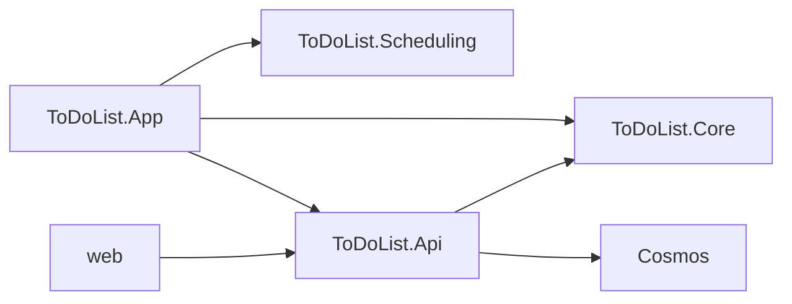

# Architecture Spine — ToDoList

## Design Paradigm

Client-computed views. The API stores account and item facts. The web app and the Android app compute Today, week, and order from those facts and the device date. Neither client has a database. The API is the only writer.



## Invariants & Rules

### AD-1 — Stored facts, computed views [ADOPTED]

- **Binds:** all
- **Prevents:** a stored Today list, a stored week, or a server clock deciding Today
- **Rule:** Cosmos stores account and item documents. Order lives only on each item's `position`. The account document has no item array. `GET /items` returns a JSON array of every item in the caller's partition, each with its `etag`, and does not filter by state or by Today. The Function App does not cache those items. Each `GET /items`, including the reload after a 409, reads that partition in Cosmos. The device date is that device's local calendar date, never UTC. Clients compute views from that date.

### AD-2 — The API is the only writer [ADOPTED]

- **Binds:** all
- **Prevents:** a client writing Cosmos, the phone calling the Static Web App for data, or a function key in front of the bearer token
- **Rule:** Both clients call the Function App URL from the setting `apiBaseUrl`. The Static Web App serves the web files only. HTTP triggers are anonymous. The route prefix is empty, so the public paths have no `/api` segment. Routes, all requiring the Google bearer token: `GET /items`, `POST /items`, `PUT /items/` plus the item id, `DELETE /items/` plus the item id, and `POST /items/changes`. Create does not retry automatically. `POST /items` returns 201 with the stored item, including `id` and `etag`. `PUT` replaces the editable fields and keeps `id`, `userId`, and `schemaVersion`. `DELETE` removes the document. `POST /items/changes` takes `{ "items": [ ... ] }` and writes those items in one Cosmos transactional batch in the caller's partition, or writes none. The batch stays within one partition, which this model already guarantees.

### AD-3 — Google sign-in per client [ADOPTED]

- **Binds:** FR-1, FR-2, NFR-1, NFR-2
- **Prevents:** a shared session, a second identity provider, an email used as the user id, or a second name for the Google client ids
- **Rule:** Each client obtains its own Google ID token and refreshes it quietly while in use. Logout discards that client's token only. The API accepts `Authorization: Bearer` only when the token audience is the web client id or the Android client id for the Play Store package. Those audiences are the Function App settings `GOOGLE_WEB_CLIENT_ID` and `GOOGLE_ANDROID_CLIENT_ID`. `userId` is the token's `sub`. A body `userId` is ignored. A function key is not identity. The first authenticated call creates the account document. A race that finds the document already there returns it.

### AD-4 — One document per item [ADOPTED]

- **Binds:** all
- **Prevents:** one items blob that both clients overwrite, completed items inflating that blob, or a second database or container name
- **Rule:** One database named `todolist`, one container named `documents`, partition key `userId` equal to the Google `sub`. The account document id is `account` and its type is `account`. Each item is its own document, type `item`, id a GUID assigned by the API on create. Completed items are documents too.

### AD-5 — Schema version on every document [ADOPTED]

- **Binds:** all
- **Prevents:** one class with every historical field optional, or a saved document left on an old version
- **Rule:** Every document has integer `schemaVersion`, starting at 1. Account and item numbers are independent. Storage types are `AccountDocumentV1` and `ItemDocumentV1`, and a new class is added when the schema changes. Those names are never reused. Application code uses `Account` and `Item` for the current fields. A read deserializes the stored version and converts it to the current type. A save writes the current version class. The server sets `schemaVersion`. A client value is ignored. A `schemaVersion` the code does not know fails the read. A new required field receives its default inside the converter.

### AD-6 — Etag on save [ADOPTED]

- **Binds:** account and item updates
- **Prevents:** a silent last-write-wins, or a merge screen
- **Rule:** `GET /items` includes `etag` on each item, copied from the Cosmos `_etag`. `PUT` and `DELETE` require that same string in the `If-Match` header, including any quotes. `POST /items/changes` requires `etag` on each object. A missing etag is rejected and writes nothing. A mismatch returns 409 and writes nothing. The client snaps the item back and reloads. `schemaVersion` is not the etag.

### AD-7 — One field contract, two checks [ADOPTED]

- **Binds:** FR-3, FR-8
- **Prevents:** each app inventing a length, or a third check after the API has already accepted the value
- **Rule:** `contracts/item-fields.json` is the only definition. JSON is camelCase. Item fields are `id`, `etag`, `description`, `detail`, `state`, `dueDate`, `completedDate`, and `position`. Description is required, trimmed, 1 to 200 characters. Detail is optional, up to 2000 characters. State is `not-started`, `in-progress`, or `done`. Dates are `YYYY-MM-DD` or null. Each client checks before send. The API checks again. After that, Core trusts the values. The server sets `id`, `userId`, and `schemaVersion`.

### AD-8 — Problem-details errors [ADOPTED]

- **Binds:** all
- **Prevents:** each client inventing an error body, or a Cosmos or exception string reaching the person
- **Rule:** The Function App uses the ASP.NET Core integration so it can return problem-details. 400 uses an `errors` map of field name to messages. 401 starts that client's sign-in. 409 snaps back and reloads. 5xx or no response shows `Error reaching server`. The body has no exception text and no Cosmos message.

### AD-9 — Display state stays on the device [ADOPTED]

- **Binds:** FR-4, FR-7
- **Prevents:** a server round trip to hide items, or a midnight timer
- **Rule:** Hide completed is stored on the device and applies across views and restarts. Today is recomputed when the app returns to the foreground. An open session does not run a clock. The week starts Monday, from one config value behind a property in Scheduling and the same value in the web app, locked by the shared JSON examples. Next week is the following Monday. Next month is the first of the next month.

### AD-10 — Same view results [ADOPTED]

- **Binds:** NFR-3, FR-9, FR-11, FR-12, FR-13, FR-15
- **Prevents:** the web app and the phone ordering or completing an item differently
- **Rule:** Today shows not-started and in-progress items due on or before the device date, then done items due that date. Overdue open items precede today, oldest due date first. A date view shows items due that date, including done. A week shows items due Monday through Sunday of that week. Sort is due date ascending, then `position` ascending, then `id` ascending. `position` is a unique integer per due date, owned by the item. Hide completed filters the display and does not change `position`. A new item is placed at the end of its date. A reschedule action (tomorrow, next week, next month, or a picked date) appends the item on the target date. A drag onto a day sets the due date and the dropped index, and that request renumbers the affected date. Setting done stores `completedDate` as the device's local calendar date sent by the client, and does not change `dueDate`. The server does not substitute its own clock. Leaving done clears `completedDate`. Shared JSON examples state membership and order. xUnit and Vitest both run them. Moving several items at once is web only.

### AD-11 — Solution shape [ADOPTED]

- **Binds:** all
- **Prevents:** a storage interface, an infrastructure project, or view rules copied without a shared fixture
- **Rule:** Projects are `ToDoList.Api`, `ToDoList.Core`, `ToDoList.Scheduling`, `ToDoList.Tests`, and `web`. The API references Core. MAUI references Core and Scheduling. Web references neither. Cosmos is a concrete class in the API. An interface exists only when two implementations exist. Tests are xUnit for Core and Scheduling, and Vitest for the web view rules. The emulator is for local running, not an API test pyramid.

### AD-12 — Tokens, not hex [ADOPTED]

- **Binds:** web and Android presentation
- **Prevents:** a color hard-coded in a component, or a phone theme picker in project 1
- **Rule:** Web colors live in `tokens.css` as `--color-background`, `--color-surface`, `--color-line`, `--color-text`, `--color-text-muted`, `--color-accent`, `--color-surface-picked`, and `--color-error`. Component classes use only those variables. A later theme is another sheet selected with `data-theme`. Project 1 ships the dark sheet. MAUI uses the same names in a resource dictionary and ships dark only.

### AD-13 — Two environments [ADOPTED]

- **Binds:** all
- **Prevents:** an always-on API bill, a second Cosmos account, a second Azure environment, or local code writing production items
- **Rule:** Production is one Azure resource group: one Static Web App, one Function App on Flex Consumption with no always-ready instances, the function storage account and user-assigned identity in AD-14, and one Cosmos DB account on the free tier created with that option selected. The Android app ships through the Play Store, and its Google client id matches that package. Each client has one `apiBaseUrl`: the production Function App host in production, the local Function App host on a developer machine. CORS allows the Static Web App origin and the local Vite origin. Local development runs Vite, the Function App, and the Cosmos vNext emulator. The free-tier account is production only. Terraform does not describe the local machine.

### AD-14 — Production identity and host storage [ADOPTED]

- **Binds:** production Azure resources and the API's Azure settings
- **Prevents:** a Cosmos key or a storage connection string in the Function App, a private network, Application Insights, or a second identity
- **Rule:** One Azure region, and it is one of `westus2`, `centralus`, `eastus2`, `westeurope`, or `eastasia`, because a Static Web App can be created only in those regions. Cosmos is Strong consistency, that single region, free tier, public network, keys disabled. Container `documents` is provisioned at 1000 RU/s, which is the free-tier allowance. The Function App uses one user-assigned managed identity. The function storage account is Standard LRS, shared keys disabled, public blobs disabled, TLS 1.2. The identity is assigned Storage Blob Data Owner, Storage Blob Data Contributor, Storage Queue Data Contributor, and Storage Table Data Contributor on that account, and Cosmos DB Built-in Data Contributor on the Cosmos account. The app runs from blob container `app-package`. Instance memory is 2048 MB. Always-ready instances stay zero. There is no virtual network, no private endpoint, and no Key Vault. App settings are `AzureWebJobsStorage__accountName`, `AzureWebJobsStorage__credential` = `managedidentity`, `AzureWebJobsStorage__clientId`, `AZURE_CLIENT_ID`, `COSMOS_ACCOUNT_ENDPOINT`, `COSMOS_DATABASE_NAME`, `COSMOS_CONTAINER_NAME`, `GOOGLE_WEB_CLIENT_ID`, and `GOOGLE_ANDROID_CLIENT_ID`. No Cosmos key and no Application Insights settings. On a developer machine the API uses the emulator connection string from local settings and does not use this identity. Usage and volume are Azure Monitor platform metrics on the Function App and Cosmos, retained 93 days. No Log Analytics workspace, no alert rules, and no usage rows in Cosmos.

### AD-15 — One Terraform stack [ADOPTED]

- **Binds:** the Terraform repository
- **Prevents:** a split security/compute repo, a module per resource, state committed to git, or Terraform publishing the app
- **Rule:** One Terraform repository and one root stack for production. Remote state is an Azure blob, container `tfstate`, key `prod.tfstate`, in a storage account and resource group the root stack does not create. Blob versioning is on. State is not committed. The only module is `modules/function_host`: the plan, the Function App, the user-assigned identity, the function storage account, container `app-package`, the four storage data roles, the Cosmos SQL role assignment, and the AD-14 app settings. The root owns the production resource group, the Cosmos account, database `todolist`, container `documents` at 1000 RU/s, and the Static Web App. The root passes the module the Cosmos endpoint URL, the database name, the container name, both Google client ids, and the Static Web App hostname. Terraform outputs the Function App host and the Static Web App host. It does not publish the zip or the web files. Resource names and the region are variables. The region is one of the five in AD-14.

## Consistency Conventions

| Concern | Convention |
| --- | --- |
| Naming | Document type `account` or `item`. API state values `not-started`, `in-progress`, `done`. Storage classes `AccountDocumentV1`, `ItemDocumentV1`. Current types `Account`, `Item`. JSON camelCase. Cosmos database `todolist`, container `documents`. |
| Data and formats | Partition key `userId` from the Google `sub` only. Account id `account`. Item id is a server GUID. Dates are `YYYY-MM-DD`. `etag` is on the item JSON and on `If-Match`. |
| State and cross-cutting | Bearer Google ID token. Problem-details `errors` map. Missing etag writes nothing. Validate at the client and again at the API. No interface without two implementations. Production Azure settings are the names in AD-14. |

## Stack

| Name | Version |
| --- | --- |
| .NET | 10 |
| .NET MAUI | 10.0.120 |
| Azure Functions | Flex Consumption, isolated worker, .NET 10 |
| React | 19.3.1 |
| Vite | 8.3.5 |
| TypeScript | 7.0.2 |
| Node.js | 24 |
| Vitest | 5 |
| xUnit | 3 (net10.0) |
| Azure Cosmos DB | API for NoSQL, free tier (1000 RU/s, 25 GB) |
| Cosmos emulator | vnext-latest |
| Azure Static Web Apps | current React host |

## Structural Seed

```text
src/
  ToDoList.Api/            # HTTP, Google token, Cosmos
  ToDoList.Core/           # item rules, schema converters
  ToDoList.Scheduling/     # Today, week, order
  ToDoList.Tests/          # xUnit
  ToDoList.App/            # MAUI
  web/                     # Vite, React, TypeScript
  contracts/item-fields.json
  contracts/view-examples.json
```

Production path: browser and phone call the Function App. The Function App reads and writes Cosmos with the user-assigned identity. The Static Web App serves `web` only. The function zip lives in the function storage account. Local path: the same Function App talks to the emulator. Resource picture: `diagrams/deployment_azure-resources.d2`. Terraform layout: `terraform.md`.

## Capability → Architecture Map

| Capability / Area | Lives in | Governed by |
| --- | --- | --- |
| FR-1, FR-2 Sign in and out | both clients, API | AD-3, AD-8 |
| FR-3, FR-8 Add and edit | clients, API, Core | AD-2, AD-7 |
| FR-4, FR-5, FR-6 Views | Scheduling, web | AD-1, AD-9, AD-10 |
| FR-7 Hide completed | each client device | AD-9 |
| FR-9, FR-10, FR-11, FR-12 State, delete, reschedule, reorder | API, Core, clients | AD-2, AD-6, AD-10 |
| FR-13, FR-14, FR-15 Parity and web multi-move | both clients | AD-2, AD-10 |
| NFR-1, NFR-2, NFR-3 Isolation and consistent results | API, Scheduling, web | AD-1, AD-3, AD-10 |

## Deferred

- iOS, extra sign-in providers, sharing, offline, and admin tools. Project 1 does not include them.
- Date-window queries and paging. Revisit when one person's items are large enough that loading the partition is slow.
- Account settings such as a per-user week start. The Monday constant stays in code until a later project.
- A phone theme picker. MAUI ships the dark tokens only.
- A batch migration job. Old documents convert on read.
- Client-generated idempotency keys for retried adds.
- A second Azure environment and always-ready Function instances.
- Application Insights, a Log Analytics workspace, Google logging, usage rows in Cosmos, and alert rules. Usage and volume stay on Azure Monitor platform metrics.
- A non-default Cosmos backup policy. The account keeps the platform default. Revisit when a restore drill is required.
- The application release pipeline that publishes the Function App zip and the Static Web App files. Terraform creates the empty resources and outputs the host names. Revisit when the application repository is created.
